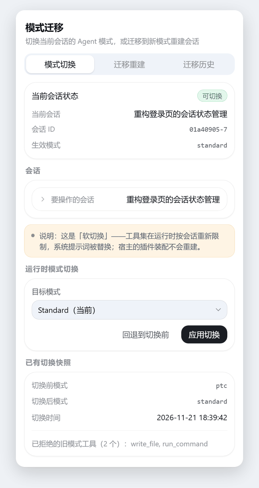
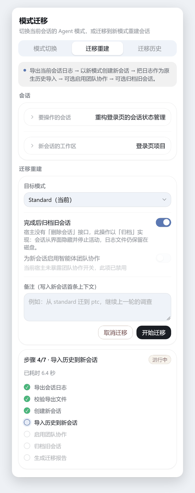
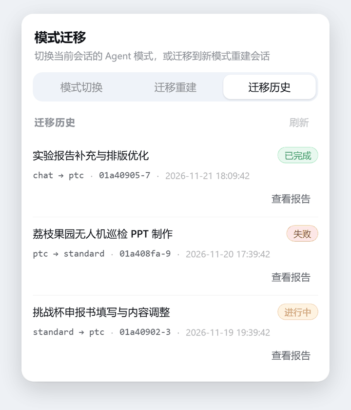
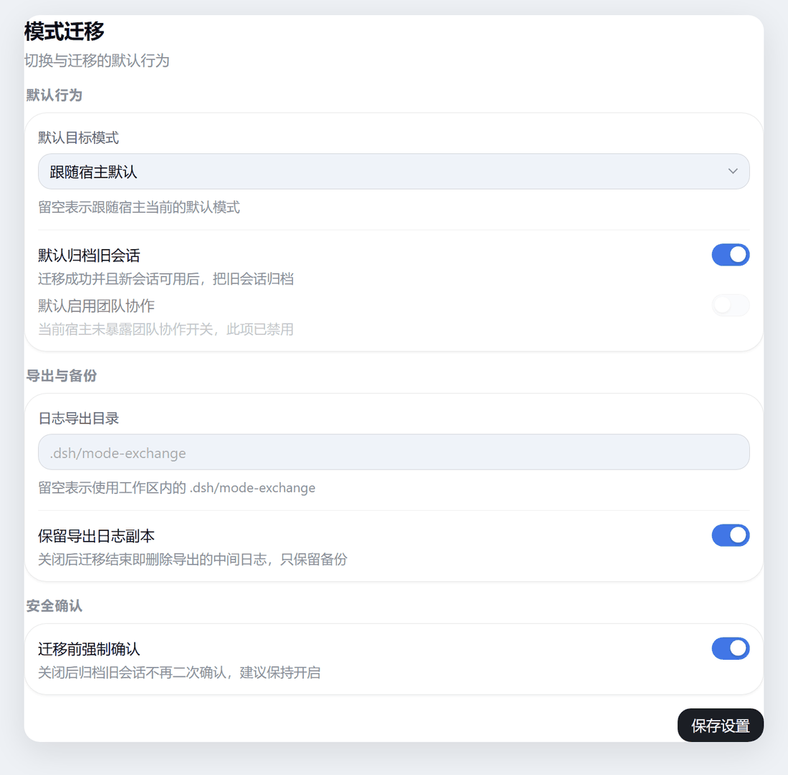

# Agent模式切换 · dsh-mode-exchange

> A generic DSH plugin to dynamically switch to any Agent mode (Standard, PTC, Code, etc.)
> in an existing session. It reconfigures the toolset and system prompt on the fly,
> eliminating the need to create a new chat.
>
> DeepSeek Harness 通用插件，支持在任意现有对话中自由切换至任何内置 Agent 模式
> （如 Standard、PTC、Code、Research 等）。通过动态重组会话的工具集与系统提示词，
> 实现无缝切换，无需中断当前任务重新创建会话。

在**已经存在的** DSH 会话里换 Agent 模式，或者把一个会话按目标模式**迁移重建**。

DSH 的模式（Standard / PTC / Code / Research …）是会话启动那一刻固化成插件组合的。
`agentPresets.select()` 只管「第一轮还没开始」的会话，已有消息的会话会被
`agent-preset/locked` 挡回来；`recompose()` 要求 Agent 是空白的。
所以对一个跑了很久的会话，官方路上只有一个选择：新建会话。

这个插件补两条路：

```
                     ┌──────────────────────────────────────┐
                     │  现有会话（模式 A，有历史，正在用）  │
                     └───────────────┬──────────────────────┘
                                     │
              ┌──────────────────────┴───────────────────────┐
              │                                              │
        【能力 A · 软切换】                          【能力 B · 迁移重建】
      /switch-mode <模式>                        /migrate-session --mode <模式>
              │                                              │
   同一个会话、同一个 ID，原地改                    新会话、真模式、真导入历史
              │                                              │
   ┌──────────┴──────────┐                        ┌──────────┴──────────┐
   │ ① 换系统提示词       │                        │ ① 导出日志           │
   │ ② 按会话拒绝旧工具   │                        │ ② 校验完整性         │
   │ ③ 补挂目标模式工具   │                        │ ③ 按目标模式建会话    │
   └──────────┬──────────┘                        │ ④ 导入原生事件序列    │
              │                                   │ ⑤ 可选：团队协作      │
   /switch-mode --revert 可撤销                   │ ⑥ 可选：归档旧会话    │
                                                  │ ⑦ 输出报告           │
                                                  └──────────┬──────────┘
                                                             │
                                                  失败保留现场 + 可续跑
```

一句话选路：**只差工具清单和提示词 → 用 A；连工具怎么执行都要变 → 用 B。**

---

## 界面预览


| 模式切换 | 迁移重建 |
| --- | --- |
|  |  |

| 迁移历史 | 设置页 |
| --- | --- |
|  |  |

> 截图为插件真实组件渲染（含演示数据），不是手绘示意图。
> 同一组图片也登记在 [screenshots.json](screenshots.json) 里，供插件市场直接取用。

---

## 功能

### 能力 A：运行时软切换

- `/switch-mode <模式名>` —— 在当前会话内切换，作用域只有这一个会话：
  - **换系统提示词**：在 `system-prompt/assemble` 瀑布里摘掉现有 section，
    换成本插件生成的、描述目标模式（含其工具清单与工作方式）的 section；
  - **卸载旧工具**：`agent.ctx.tools.restrict({ deny })` 把「当前有、目标没有」的工具
    从**声明和派发两侧**一起去掉 —— 模型看不见，调用也会被拒；
  - **补挂新工具**：`agent.ctx.tools.register()` + `when` 门控，把「目标有、当前没有」的工具
    注册进会话作用域；
  - 另挂一道 `tools.guard` 兜底，防止绕开 schema 直接派发。
- `/switch-mode --revert` —— 按入口快照整体回退。
- `/switch-mode --list` —— 运行时枚举全部模式（**零硬编码**），标出当前、默认、装配失败的。
- 快照落盘 `state/switches.json`，改设置触发插件重建后会自动读回并重建。
- 不可切换的会话（不存在 / 已归档 / 子代理 / 无活 Agent / 无作用域）给具体中文原因，
  不静默失败。

### 能力 B：迁移重建（七步）

1. **导出** → `<导出目录>/exports/<YYYYMMDD-HHmmss>-<短ID>.jsonl` + `.meta.json`（含 sha256）
2. **校验** → 逐行可解析 / 事件数一致 / `seq` 从 0 连续 / sha256 匹配；失败即中止、现场保留
3. **建会话** → 以目标模式为 `agentPreset` 创建，并在 `setup` 里 `agentPresets.mount()` 真装配
4. **导入** → 原生事件序列作为 constructor seed 写入（**不是复述**）：
   ```
   源事件前缀（seq 0..N-1）
     + session/end-seed{inherited:true}   ← 正好落在 index = inheritedEventCount
     + 收尾事件：未闭合 turn/step 补 step/end、turn/end；
                没拿到结果的工具调用补 isError 的 tool/result
                （TOOL_OUTCOME_UNKNOWN / TOOL_NOT_STARTED，附宿主原文的「别盲目重试」提示）
   ```
5. **团队** → `--team on` 时对根 Agent 调 `agentTeams.setEnabled(true)`，再回读 `isEnabled` 复核
6. **归档** → `--delete-old true` 时先备份再归档旧会话（见「已知限制」）
7. **报告** → 新旧会话 ID、日志路径、消息数、工具调用数、团队状态、旧会话处置、耗时、时间线

配套保障：

- **幂等**：台账 `migrations/<源会话ID>.json` 按源会话记进度；重复执行不产生第二个新会话，
  而是让你选「续跑 / 放弃」。
- **失败不丢东西**：新会话建好但导入复核失败时，新会话与日志都保留，报告列出可手动完成的剩余步骤。
- **失败必有原因**：真实报错同时写进报告的 `error` 字段与 `remainingSteps` 第一条
  （「失败原因：…」），面板在失败徽章下方直接显示；不再只留一句「中止在第 N 步」。
- **迁移完停在新会话**：成功后自动把主视图切到新建会话并用 `workspaceRegistry.pinSession`
  置顶（结果记在 `target.pinned`）；设置里可关（`autoOpenTarget`）。
- **来源标记（FR-12）**：新会话首条追加一条消息，写明「由会话 X 于时间 T 迁移而来、
  原模式 A → 新模式 B」，并带上 `--note`。
- **导出副本策略**：`keepExportCopy=false` 时成功结束后删除导出文件；失败一律保留。

### 界面

- **侧栏面板**（`sidebar.panellist` + `main`，id/key 都是 `mode-exchange`）：
  - 「切换」：**会话标题**（短 id 退到「会话 ID」一行）、当前生效模式、可否切换、
    **可折叠的「选择会话」窗口**（按标题 + 所属工作区认会话，默认你刚点进来的那个）、
    目标模式下拉 + 应用/回退、入口快照、软切换警示；
  - 「迁移」：**可折叠的「选择会话」与「选择工作区」窗口**（新会话默认加入目标会话所在工作区）、
    目标模式、归档旧会话（默认开）、团队协作（不支持时置灰并说明原因）、备注、
    执行/取消、续跑卡片、七步进度与耗时、报告；
  - 「历史」：时间 / 源会话 / 目标会话 / 结果，点开看报告，一键打开目标会话。
- **会话右键菜单**（`contextMenus` 的 `session` / `sessionHeader` target）：
  在左侧会话列表里右键任意对话，有两条二级菜单：
  - 「切换模式」：列出全部模式，当前模式标「（当前）」、装配失败的模式置灰、
    点一下就完成软切换并用宿主 toast 反馈结果；会话不可切换时菜单里直接写明原因
    （无活 Agent / 已归档 / 子代理等）。
  - 「迁移重建」：同样列出全部模式，点一下直接发起迁移重建（参数取设置页的默认值），
    发起后提示条带「查看进度」，点了自动打开本插件面板并接着显示七步进度。
    **切换做不了的会话（没有活着的 Agent、已归档）这里仍然能迁移** —— 这正是它的用途；
    迁移进行中菜单里的模式会置灰，避免重复发起。

  宿主没提供 `contextMenus` 时菜单缺席，其余功能不受影响。
- **设置页**（`settings.section` + `settings.section.icon`）：默认目标模式、默认是否归档旧会话、
  默认是否启用团队协作、日志导出目录、是否保留导出副本、是否迁移前强制确认（关掉要二次警告）、
  迁移成功后是否自动打开新会话（并置顶）。
- 侧栏与设置页共用同一份持久化配置，改完即时同步。

---

## 安装

需要 DSH `>=0.2.2-rc.3 <0.3.0`、Node 22+。**没有 install 脚本，没有构建期依赖。**

**从 npm 装（已发布时最简单）**：侧栏 **插件** → **添加插件** → 输入包名 `dsh-mode-exchange`，
装完点「立即启用」即可。等价的工具调用：

```
plugin_manager({ action: "install_bundle", target: "dsh-mode-exchange" })
```

**从本地目录装（开发期）**：

```
plugin_manager({ action: "install_bundle", target: "<本仓库的绝对路径>" })
```

装完确认：

```
plugin_manager({ action: "list_plugins" })   // 状态应为 active
```

> 本地目录安装是**链接整个 checkout**，`files` 不生效 —— 想干净就单独 copy 一份再装。
> **替换已安装的包必须重启宿主**，不会热换 JS 模块世代。
> 别手改 profile 的 `cordis.patch.yml`，那是最容易把 profile 弄坏的一步。

开发期想直接挂载、或者要装到别的 profile，见 [docs/LOCAL-DEV.md](docs/LOCAL-DEV.md)。

---

## 使用示例

### 例 1：把一个长会话切成 PTC

```
/switch-mode --list
  → 可用模式（4 个）：
    · standard (标准)（当前）
    · ptc (PTC)（运行时默认） — 通过单次代码执行工具驱动工作
    · code (代码)
    · research (研究)

/switch-mode ptc
  → 已切换至「PTC」模式，工具集已变更。
    已卸载（目标模式不提供）：read_file、write_file、list_dir …
    已补挂（目标模式新增）：run_code
    注意：本次只做了提示词层切换，工具的**执行方式**没有改变；
          要真正用上 PTC 的代码执行通道，请用 /migrate-session --mode ptc 重建会话。

/switch-mode --revert
  → 已回退到切换前的状态：standard 模式。
```

### 例 2：把一个会话迁到 PTC，保留旧会话

```
/migrate-session --mode ptc --delete-old false --note "切到 PTC 继续做重构"
  → 迁移已开始（任务 3f2a1b9c），共 7 步：
    ① 导出会话日志 ② 校验完整性 ③ 以目标模式创建新会话 ④ 导入历史
    ⑤ 团队协作 ⑥ 归档旧会话 ⑦ 报告
    目标模式：PTC（ptc）
    旧会话：保留
    团队协作：不启用
```

在侧栏面板看着七步跑完，报告里能看到新会话 ID 与日志路径。
打开新会话，历史消息与工具调用都在，直接接着聊。

### 例 3：迁移 + 开团队 + 归档旧会话

```
/migrate-session --mode ptc --team on --yes
```

没带 `--yes` 时，为安全起见**不会**归档旧会话（命令会明说）。
带了 `--yes` 就按配置里的「先备份再删除」执行：备份到 `backups/`，然后归档旧会话。
面板路径走的是确认对话框，展示旧会话标题、消息数、日志路径，并可选「先备份」。

### 例 4：只想归档一个旧会话

侧栏面板「历史」页签或 `POST /api/mode-exchange/archive-old`，
带 `confirm` 与 `backup` 参数。

---

## 已知限制

### 1. 能力 A 是「软切换」，不是真模式

| | 真模式装配（新建会话） | 本插件软切换 |
| --- | --- | --- |
| 插件组合 | 按预设声明挂载 | **不变**，只改提示词与工具可见性 |
| 工具执行器 | 由预设决定（native / PTC） | **不变** —— PTC 的 `run_code` 传输层不会因切换出现 |
| 会话 ID | 新的 | 不变 |
| 历史 | 复制过去 | 原地保留 |
| 子代理 / 团队 | 按新预设 | 不变 |

**能做到**：目标模式有哪些工具、提示词怎么写、模型看见的工作方式。
**做不到**：换掉工具的执行通道。软切换后调用被卸载的工具会被拒绝（有明确报错），
而不是"看起来能用其实没走对通道"。命令返回和面板都会主动告知这一点。

### 2. FR-9 的「删除旧会话」实现为 **归档**

DSH **没有删除会话的 API**：

- 工作区服务只有 `archiveSession` / `unarchiveSession` / `pinSession`；
- `workspaceRegistry.delete()` 删的是**工作区**，不是会话；
- 会话日志文件是持久层的，插件这一层拿不到删除句柄。

所以这里的「删除」= 归档：

- 从所有分组界面隐藏、从置顶列表移除；
- 按要求停止其活动；
- **磁盘上的日志文件仍在**，可以用 `unarchiveSession` 反悔。

如果你期待「数据被抹掉」，归档做不到；如果你期待「它别出现在我的列表里」，归档正好。
报告里一律写「已归档」，不写「已删除」。

此外归档**可能延后**：`/migrate-session` 跑在旧会话的 Agent 里，当场归档自己会打断工作。
实现是「先尝试停掉活动再归档；若宿主要求当前回合结束后才能停，就排到微任务重试」，
报告里标「已排期」。

### 3. FR-1 的 Tab 补全做不成结构化候选

宿主 `CommandInputDescriptor` 只有 `hint: string`，**没有参数级枚举字段**，也没有补全回调。
所以：

- 补全信息写进 `input.hint`；
- `/switch-mode --list` 与错误文案完整列出运行时枚举结果（零硬编码）；
- 交互式选择交给侧栏面板的下拉框。

### 4. 团队协作开关有前置条件

`agentTeams.setEnabled(agent, enabled)` 只接受 **root Session 的活 Agent**，
从子代理调用会抛 `TEAM_LEAD_REQUIRED`；新值要等到「下一次 step 准备」才影响工具可见性。
运行时探测不到这个能力时，面板开关置灰并说明原因，报告记「未启用 + 原因」，**不伪造成功**。

### 5. 其他

- 迁移会换会话 ID：新会话是真正的另一个会话，`parentSession` 不建立父子关系（当前实现）。
- `--mode` 必填；不填会报错并提示先 `/switch-mode --list`。
- 跨工作区迁移以源会话的 `cwd` 为准；匹配不到工作区时只是不进工作区分组，不影响迁移。

---

## 目录结构

```
package.json            manifest（dsh.bundle.patch / dsh.client）
cordis.patch.yml        bundle 挂载行与默认配置
icon.svg                SVG 图标（源文件，宿主与市场取 PNG）
assets/                 图标 PNG（180 / 512）与四张界面截图
screenshots.json        界面截图清单（插件市场按此取图）
index.js                宿主入口：装配服务、能力探测、注册命令与路由
src/host/
  config.js             配置 schema 与数据目录布局
  services.js           宿主服务解析、能力探测、会话读取辅助
  modes.js              模式枚举（唯一数据源：agentPresets.list()）
  switch.js             软切换核心（restrict / register / 提示词瀑布 / 快照）
  guard.js              会话级 tools.guard
  snapshot.js           切换快照落盘与读回
  export.js             导出、校验、备份
  seed.js               constructor seed 构造（prefix + marker + closers）
  ledger.js             迁移台账（幂等与续跑）、报告读写
  migrate.js            七步迁移任务
  routes.js             /api/mode-exchange/* 路由
  util.js               参数解析、哈希、时间、文件等纯函数
src/client/
  entry.js              客户端入口（插槽注册、会话订阅）
  api.js / store.js     路由客户端与状态容器
  ui.js / panel.js      组件库、侧栏面板
  settings.js           设置页
  i18n.js               中英文字典
  bundle.js             构建产物（由 scripts/build-client.mjs 生成）
types/                  TypeScript 声明
locale/                 插件页标题与描述（zh / en）
docs/                   详情页、本地调试说明
docs/market/            投稿到 awesome-dsh-plugin 的条目文件
scripts/                build-client.mjs（零依赖打包）、probe.js（体检）、smoke-*.mjs（冒烟）、
                        publish-npm.*（发 npm）、push-retry.*（git 推送失败重试）
LICENSE                 MIT
.gitignore              依赖、构建产物、本地取证目录
```

> 开发和排查用的 `.verify/`、`.refs/`、`.dsh-vision-router/` 属于本地取证产物
> （含桌面截图与从宿主安装包里抽出的参考资料），已在 `.gitignore` 里排除，不入库。

---

## 文档

- [docs/DETAIL.md](docs/DETAIL.md) —— 原理、为什么叫「软」切换、七步的细节、安全边界
- [docs/LOCAL-DEV.md](docs/LOCAL-DEV.md) —— 本地加载、调试、冒烟测试清单、踩坑
- [docs/PUBLISH.md](docs/PUBLISH.md) —— 发布到 GitHub 的三种方式、PAT 权限、常见报错；发布到 npm registry 供 DSH 用户在线安装；链路被 reset 时的排查与重试
- [docs/market/dasuda13__dsh-mode-exchange.yml](docs/market/dasuda13__dsh-mode-exchange.yml) —— 提交到 awesome-dsh-plugin 收录列表的条目文件（市场收录用，不是运行时资源）
- [CHANGELOG.md](CHANGELOG.md) —— 变更记录

## 许可

[MIT](LICENSE)。插件没有第三方运行时依赖：宿主服务通过 `ctx` 获取，
配置校验是手写的 standard-schema v1，源码里只用到 `node:*` 内置模块。
